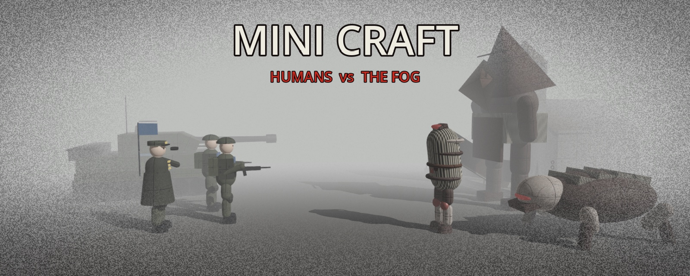

# MINI CRAFT

**English** · [Русский](README.ru.md)

A real-time strategy game in the spirit of StarCraft, set in a Silent Hill–like fog.
A human field army fights the creatures of the Fog: build a base, mine minerals, raise an army and destroy the enemy.

- **Two factions** — Humans (soldiers, APCs, rocket artillery, jets, a heavy tank) and the Fog (twisted creatures,
  rusted bloody buildings, the Executioner; everything of the Fog regenerates).
- **Squads** — commanders lead up to 6 soldiers or 4 vehicles / aircraft and make them stronger.
- **Ages** — like Age of Empires: tougher buildings, energy shields, stronger units.
- **Missiles** — tactical, cluster, napalm and heavy, fired from a silo.
- **Fog of war**, armor and target classes, save / load, two difficulty levels, English and Russian.

## Run

1. Install [Godot 4.3+](https://godotengine.org/download) (standard version, not .NET).
2. `git clone https://github.com/r0mik/rts-craft.git`
3. Open `project.godot` in Godot and press **F5**.

Standalone builds for Windows / Linux: [HOW_TO_RUN.md](HOW_TO_RUN.md).

## Controls

| | |
|---|---|
| Select / order | LMB, box select / RMB |
| Camera | `WASD`, mouse wheel, `Space` — to base |
| Attack-move / stop / hold | `G` / `X` / `H` |
| Groups | `Ctrl+1..9`, `1..9` |
| Squad (commander + units) | `Z` add, `U` disband |
| Next age | HQ → `E` |
| Quick save / load | `F5` / `F9` |
| Pause, settings | `Esc` |

All commands are also on the buttons at the bottom right, with tooltips. Balance lives in `scripts/defs.gd`.

### Touch screens (iPad)

Touch controls turn on by themselves at the first touch; a mouse click switches back.

| | |
|---|---|
| Select | tap a unit or building; drag a finger for a box; double tap — every unit of that kind on screen |
| Order | tap the ground or an enemy with units selected; hold a finger anywhere (also sets rally points) |
| Camera | two fingers: drag to pan, pinch to zoom; tap the minimap |
| Build | pick a building, move it with your finger, lift to place |
| Keyboard keys | buttons on the right: Menu, Cancel, Army, Base, **+ Select** (adds to the selection), groups 1–4 (tap — select, hold — assign) |

To install on an iPad, see [HOW_TO_RUN.md](HOW_TO_RUN.md#ipad).
