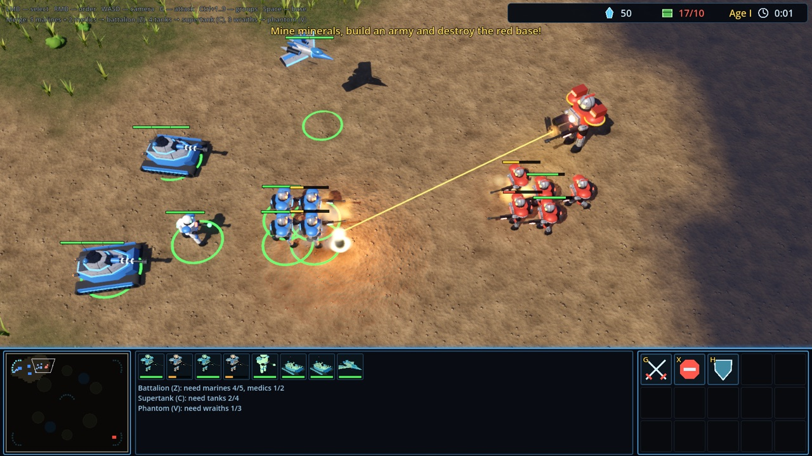
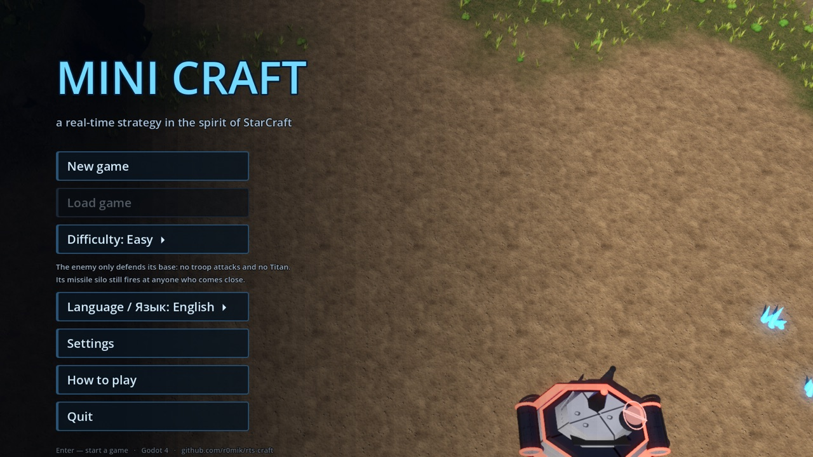
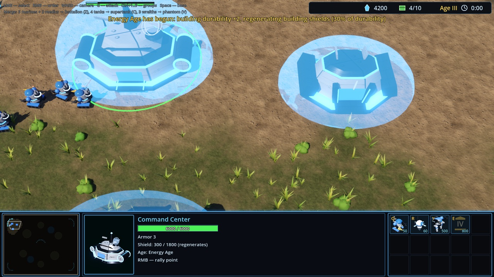
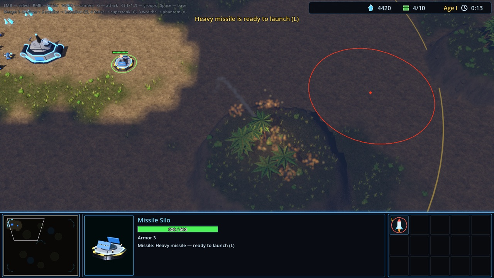
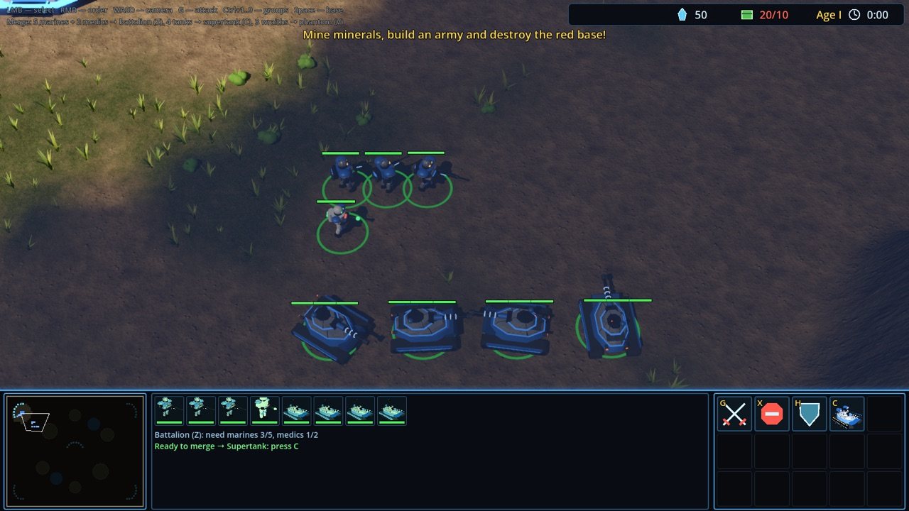
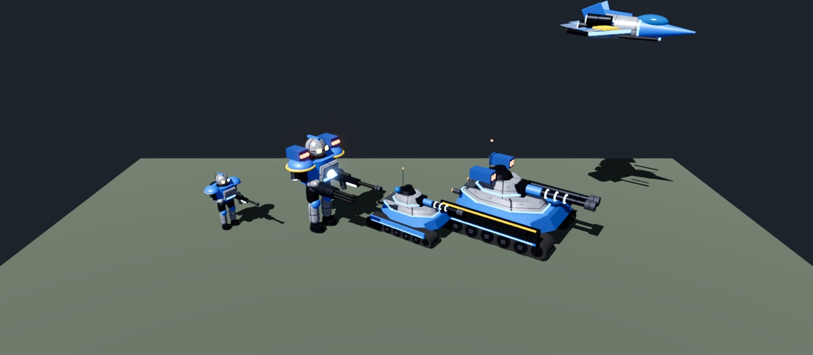

# MINI CRAFT

**English** · [Русский](README.ru.md)

**A real-time strategy game in the spirit of StarCraft — with Age of Empires–style ages, merging super units and missile silos.**
Build a base, raise an army of infantry, tanks and aircraft, fuse squads into super units, lead your base through four ages
and wipe out the enemy with tactical, cluster and napalm missiles. Fully 3D, free and open source.

  <b>Godot 4</b> · Windows · Linux · macOS · English and Russian · save games · free and open source

---

## Why play

- ⚔️ **Classic RTS you know from the first minute.** Workers mine minerals, you build barracks, a factory and a starport,
  drag-select your army and right-click it into battle. A StarCraft-style interface: minimap, live 3D portrait,
  command card with hotkeys.
- 🧬 **Super units.** Five marines and two medics fuse into a **Battalion** with a rotary cannon, four tanks into a
  **Supertank** with a twin gun, three fighters into a **Phantom**. Each one beats its parts — and each has a weak spot.
- 🏛️ **Ages, like in Age of Empires.** Lead your base from the Colony Age to the Stellar Age: buildings get twice as tough,
  gain regenerating energy shields, and your army gets a power boost.
- 🚀 **Missile silos.** Four kinds of missiles: tactical, cluster, napalm and heavy. The missile flies on an arc, the impact
  zone is marked in advance, and the blast hits everyone — enemies and your own units alike.
- 🤖 **Unusual units.** A Titan boss with a random name and stats, a bomber that only hits buildings, kamikaze drones,
  a scout with sensor beacons, medics and mechanics that heal and repair your army mid-battle.
- 🛡️ **Fair combat mechanics.** Armor and target classes: infantry barely scratches tanks, tanks crush vehicles and buildings,
  and only AA, turrets and fighters can shoot down aircraft. A blob of marines alone won't take a base.
- 🌫️ **Fog of war and scouting.** You only see what your troops see. The scout and its beacons reveal the map.
- 🎨 **A living 3D world.** Shadows, glow, explosions, smoke, missiles with smoke trails, palms swaying in the wind, animated
  lakes, buildings that rise as holograms with welding sparks, marching infantry and tank turrets tracking their targets.
- 💾 **Comfortable.** A main menu with a live battle in the background, two difficulty levels, English and Russian, pause,
  three save slots plus quick save (`F5` / `F9`), and settings for graphics, camera and game speed.

## Screenshots

| | |
|---|---|
|  |  |
| **Main menu** — a live AI battle plays in the background | **Energy Age** — buildings under shields |
|  |  |
| **Missile launch** — silo range circle and blast radius | **Merging** — the game tells you what's missing |
|  |  |
| **Super units** next to regular ones: Battalion, Supertank, Phantom | **Titan** — a boss with random stats |

## How to start

**With Godot (easiest):**

1. Install [Godot 4.3+](https://godotengine.org/download) (the standard version, not .NET).
2. Get the game: `git clone https://github.com/r0mik/rts-craft.git`
   (or as an [archive](https://github.com/r0mik/rts-craft/archive/refs/heads/main.zip)).
3. In Godot, click *Import*, pick `project.godot` and press **F5**.

**A standalone build without Godot** (a Windows `.exe` or a Linux binary) takes a single command —
see [HOW_TO_RUN.md](HOW_TO_RUN.md) (in Russian).

The game starts in English or Russian depending on your system language; switch it in **Settings → Language / Язык**.

## Your first five minutes

1. In the main menu, pick a difficulty: **Easy** — the enemy only defends, so you can learn in peace;
   **Normal** — a full AI that grows its army and attacks in waves.
2. Workers mine minerals on their own. Select a worker and build a **Supply Depot** (`V`) and **Barracks** (`B`).
3. Select the barracks and train marines (`Q`) and medics (`E`). Once you have 5 + 2, press `Z` to get a Battalion.
4. Build a **Factory** (`F`) for tanks, AA and mechanics, then a **Starport** (`P`) for aircraft.
5. Press `E` at the Command Center to advance to a new age and harden your base.
6. Scout the map with a Seeker (`R` at the Command Center) and destroy every red building.

Stuck? The main menu has a "How to play" page, and every button at the bottom of the screen shows a tooltip.

## Controls

| Action | How |
|---|---|
| Select | LMB or drag a box, `Shift` — add to selection |
| Order: move, attack, mine | RMB |
| Attack-move / stop / hold position | `G` + click / `X` / `H` |
| Groups | `Ctrl+1..9` — assign, `1..9` — select, double press — jump to group |
| Camera | `WASD` or arrows, screen edge, mouse wheel — zoom, `Space` — to base, click the minimap |
| Merge units | `Z` battalion, `C` supertank, `V` phantom |
| Next age | Command Center → `E` |
| Missiles | silo → `M` / `J` / `N` / `K` to build, `L` + click to launch |
| Quick save / load | `F5` / `F9` |
| Pause, save, settings, back to menu | `Esc` |

Every command is also on the command card buttons at the bottom right.

---

## Everything about the game

<b>Buildings</b>

Built by a worker: select it and press the key.

| Key | Building | Cost | Requires | HP / armor | Provides |
|---|---|---|---|---|---|
| `C` | Command Center | 400 | — | 1500 / 3 | workers, Seeker, Titan, ages, mineral drop-off, +10 supply |
| `V` | Supply Depot | 100 | — | 400 / 1 | +8 supply (max 200) |
| `B` | Barracks | 150 | — | 1000 / 2 | marines, medics |
| `U` | Bunker | 100 | Barracks | 550 / 4 | gun emplacement (7 damage, range 150); `R` — repair for minerals |
| `E` | Engineering Bay | 125 | — | 850 / 1 | weapons (`G`) and armor (`R`) upgrades, up to 3 levels |
| `T` | Missile Turret | 100 | Engineering Bay | 300 / 2 | air defense: ×2 damage against air, range 230 |
| `F` | Factory | 200 | Barracks | 1250 / 2 | tanks, AA, mechanics |
| `P` | Starport | 200 | Factory | 1300 / 2 | fighters, missile bombers, bombers, drones |
| `M` | Missile Silo | 200 | Engineering Bay | 600 / 3 | four kinds of missiles |

<b>Units</b>

| Unit | Where / key | Cost | HP / armor | Class | Damage / range | Notes |
|---|---|---|---|---|---|---|
| SCV (worker) | CC `Q` | 50 | 45 / 0 | infantry | 5 / melee | mines minerals, builds |
| Seeker (scout) | CC `R` | 60 | 55 / 0 | infantry | — | unarmed, very fast, sight 460; `F` — a beacon that sees everything around for 90 s |
| Marine | Barracks `Q` | 50 | 45 / 0 | infantry | 6 / 130 | the backbone of the army, can't hit air |
| Medic | Barracks `E` | 75 | 60 / 0 | infantry | — | heals infantry for 14 HP/s, walks up to the wounded |
| Siege Tank | Factory `T` | 150 | 160 / 4 | vehicle | 30 / 240, splash | crushes vehicles and buildings, weak against infantry |
| AA Rover | Factory `Y` | 125 | 140 / 3 | vehicle | 20 / 280 | hits air only |
| Mechanic | Factory `R` | 100 | 120 / 2 | vehicle | — | repairs vehicles, aircraft and buildings for 18 HP/s |
| Wraith (fighter) | Starport `V` | 150 | 120 / 1 | air | 10 / 150 | flies high; infantry and tanks can't reach it |
| Stormbird (missile bomber) | Starport `B` | 300 | 280 / 2 | air | 32 / 240, splash | missile salvos against ground and air |
| Devastator (bomber) | Starport `N` | 400 | 280 / 3 | air | 120 / 200 | attacks buildings only |
| Kamikaze Drone | Starport `K` | 100 | 40 / 0 | air | 250 | dives into a building and explodes |
| Titan (boss) | CC `Y` | 500 | ~1400 / 6 | vehicle | ~40 / 220, splash | one per side; random name and stats |

<b>Super units</b>

Select the right units and press "Merge" — they gather and fuse into one with a flash. Supply is kept.

| Key | Super unit | Made from | HP / armor | Strength | Weakness |
|---|---|---|---|---|---|
| `Z` | Battalion | 5 marines + 2 medics | 800 / 3 | splash rotary cannon, self-repairs 15 HP/s | slow, can't hit air |
| `C` | Supertank | 4 tanks | 1500 / 7 | 150 splash damage, range 300 | very slow, can't fire closer than 90 |
| `V` | Phantom | 3 fighters | 600 / 2 | twice the firepower of three fighters | slower than a fighter |

<b>Combat</b>

- **Armor** is subtracted from every hit (at least 1 damage): a marine does 2 per shot to a tank and 1 to a supertank.
- **Target classes** — infantry, vehicles, air, buildings. Weapons are more or less effective against each:

  | Attacker | infantry | vehicles | air | buildings |
  |---|---|---|---|---|
  | tank, supertank | ×0.5 | ×1.5 | — | ×2 |
  | Titan | ×0.8 | ×1.3 | ×1 | ×1.5 |
  | marine | ×1 | ×1 | — | ×0.8 |
  | battalion | ×1 | ×1.2 | — | ×0.7 |
  | fighter, phantom | ×1 | ×0.8 | ×1.4 | ×0.5 |
  | missile bomber | ×1.2 | ×1 | ×1 | ×0.7 |
  | bunker | ×1.3 | ×0.6 | — | — |
  | missile turret | ×0.5 | ×0.5 | ×1 (plus ×2 bonus against air) | — |

- **Upgrades** at the Engineering Bay, 3 levels (100 / 175 / 250): +10% damage or armor per level, but at least +1.

<b>Ages</b>

| Age | Cost / time | Requires | Bonus |
|---|---|---|---|
| I Colony | — | — | starting age |
| II Industrial | 300 / 45 s | Barracks | building durability ×2 |
| III Energy | 500 / 60 s | Factory | durability ×2 and building energy shields (30% of durability) |
| IV Stellar | 800 / 80 s | Starport | durability ×2, shields 60%, units +25% HP and damage |

Shields absorb damage first and recharge after 4 s without hits — shown as a blue dome.

<b>Missiles</b>

| Key | Missile | Cost | Effect | Range |
|---|---|---|---|---|
| `M` | tactical | 100 | 220 damage, radius 120 | 1500 |
| `J` | cluster | 175 | 7 bomblets of 110 damage over radius 220 | 1500 |
| `N` | napalm | 150 | burning ground in radius 160 for 8 s, 35 damage/s | 1500 |
| `K` | heavy | 300 | 600 damage, radius 210 | 1100 |

Launch with `L` + click inside the silo's yellow range circle. The blast hits everyone, including your own units.

<b>Enemy, fog of war, saves and settings</b>

- **Enemy.** On Easy, red only defends its base (but still advances through the ages, merges troops and fires missiles
  at anything that comes close). On Normal it plays the full AI: vehicles, aircraft, the Titan and attack waves.
- **Fog of war.** Explored ground is darkened, unexplored ground is almost black; enemy units in the fog are hidden,
  while buildings you've seen stay on the map. The fog can be turned off in the settings.
- **Saves.** Three slots plus quick save (`F5` / `F9`); load from the pause menu or the main menu. The whole match is saved:
  resources, ages, upgrades, units, construction, queues, loaded missiles and the explored map.
- **Settings** (main menu or pause): language, display mode (window, fullscreen or borderless full screen), window
  resolution (1280×720 to 3840×2160), v-sync, graphics quality (low / medium / high), FPS counter,
  camera speed, edge scrolling, game speed (×0.75–×1.5), fog of war and health bars over every unit.

---

## For developers

The game is written in GDScript; the logic (AI, combat, economy) is 2D, and a 3D layer (`scripts/view3d.gd`) renders it.
All models are built from primitives in code, so there are almost no assets. Balance lives in one file — `scripts/defs.gd`.
Texts are written in Russian and translated by `scripts/i18n.gd`.

| File | Purpose |
|---|---|
| `menu.tscn`, `scripts/menu.gd` | main menu (start scene) with an AI battle in the background |
| `main.tscn`, `scripts/main.gd` | a match: map, input, orders, combat, missiles, ages, merging, fog, saves |
| `scripts/defs.gd` | stats of units, buildings, upgrades, missiles, ages, recipes, armor and damage multipliers |
| `scripts/unit.gd`, `scripts/building.gd` | a unit (state machine) and a building (construction, queues, shields, defense) |
| `scripts/ai.gd` | the computer opponent |
| `scripts/view3d.gd`, `scripts/models.gd` | 3D view, animations, effects and models built from primitives |
| `scripts/hud.gd`, `scripts/overlay.gd`, `scripts/minimap.gd` | interface, pause, saves, settings, minimap |
| `scripts/settings.gd`, `scripts/i18n.gd` | player settings (`user://settings.cfg`) and the English translation |
| `scripts/terrain.gd`, `scripts/doodads.gd`, `scripts/*.gdshader` | terrain, vegetation, ground / water / fog shaders |
| `tools/export.sh` | builds standalone Windows and Linux versions |

**Autotest:** `godot --headless --path . --fixed-fps 30 --quit-after 20000 -- --autotest` runs an AI-vs-AI match
and prints stats every 30 seconds.

**Ideas for the future:** navmesh pathfinding, ramps onto plateaus, gas, AI expansions, more maps, sound and music.
Suggestions and pull requests are welcome!
