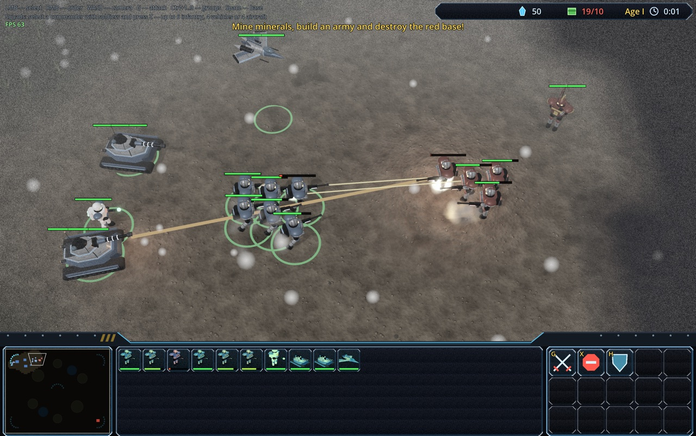
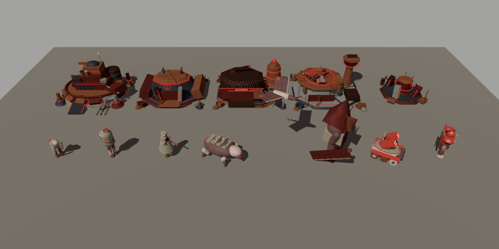
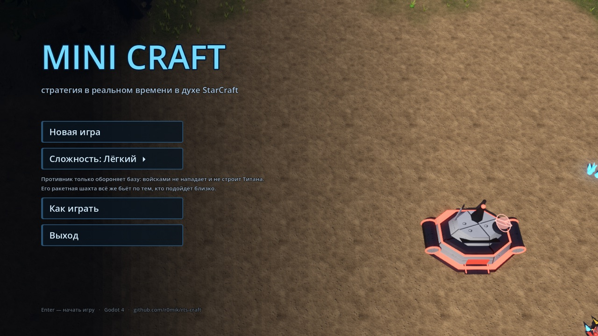
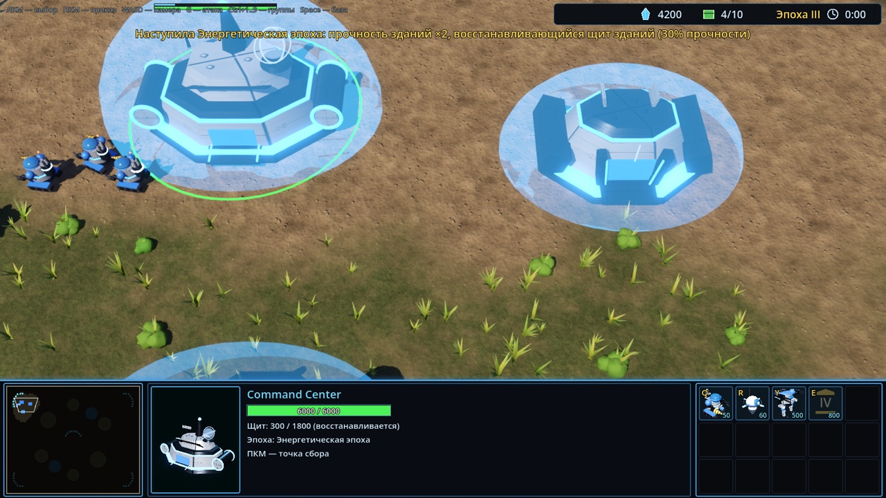
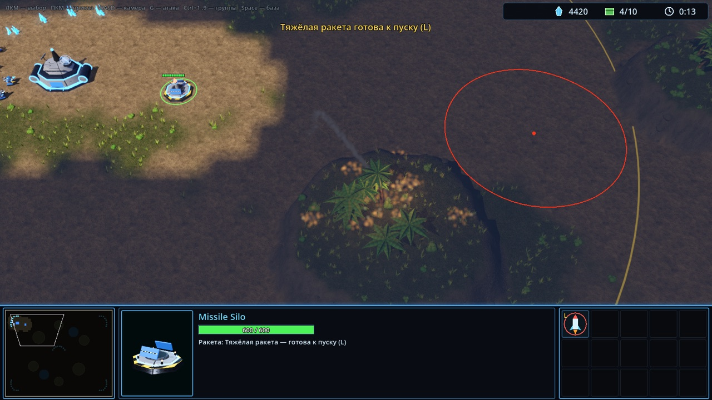
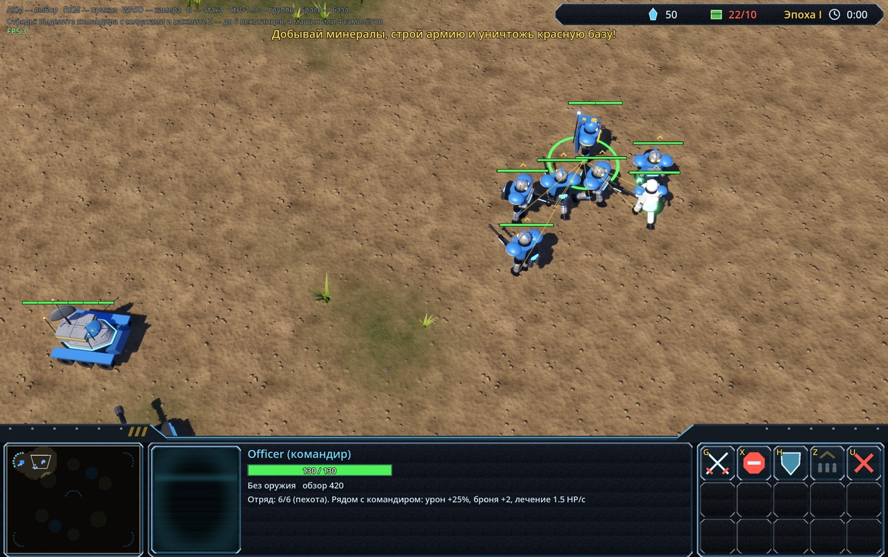
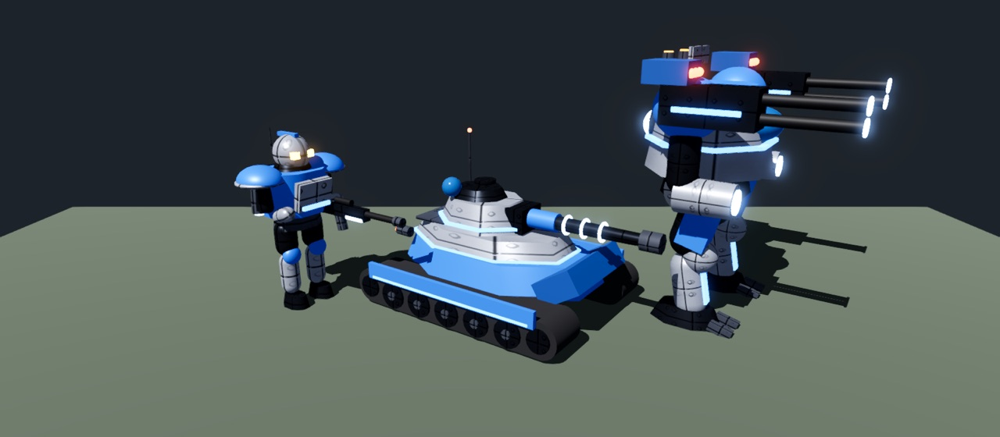

# MINI CRAFT

[English](README.md) · **Русский**

**Стратегия в реальном времени в духе StarCraft — с эпохами из Age of Empires, отрядами с командирами и ракетными шахтами.**
Стройте базу, собирайте армию из пехоты, танков и авиации, собирайте отряды под командованием командиров, ведите базу через четыре эпохи
и сносите врага тактическими, кассетными и напалмовыми ракетами. Всё в настоящем 3D, бесплатно и с открытым кодом.

  <b>Godot 4</b> · Windows · Linux · macOS · русский и английский · сохранения · бесплатно и с открытым кодом

---

## Две фракции

Сторона выбирается в главном меню (**Фракция**), противник играет за другую.

- **Люди** — колонисты, база которых наспех собрана из разномастных модулей: техника, авиация, медики и механики.
- **Туман** — фракция в духе Silent Hill: ржавые окровавленные постройки в цепях (Алтарь, Лечебница, Скотобойня,
  Гнездо…) и искажённые твари — Сборщики, Коконы в смирительных рубашках, плюющиеся кислотой, безликие Сиделки,
  слепые Звери, Летуны и Палач с огромным ржавым шлемом и тесаком. Всё, что живёт в Тумане, медленно регенерирует (1,5 HP/с).

Весь мир окутан густым белым туманом с падающим пеплом, плоским серым светом, выцветшими цветами и плёночным зерном.

## Почему стоит сыграть

- ⚔️ **Классика RTS, которую узнаёшь с первой минуты.** Рабочие добывают минералы, вы строите казармы, завод и космопорт,
  рамкой выделяете армию и правой кнопкой отправляете в бой. Интерфейс — как в StarCraft: миникарта, живой 3D-портрет,
  командная карта с горячими клавишами.
- 🎖️ **Отряды и командиры.** Наймите командира в казарме, командирскую машину на заводе или командирский корабль
  в космопорте и дайте ему до 6 солдат или до 4 машин или самолётов. Сам командир не стреляет, но видит далеко, как
  разведчик; отряд следует за ним, а рядом с ним бьёт сильнее, получает меньше урона и (пехота) лечится.
- 🏛️ **Эпохи, как в Age of Empires.** Ведите базу от Колонии к Звёздной эпохе: здания становятся вдвое прочнее,
  получают восстанавливающиеся энергощиты, а армия — бонус к силе.
- 🚀 **Ракетные шахты.** Четыре вида ракет: тактическая, кассетная, напалм и тяжёлая. Ракета летит по дуге, место удара
  подсвечено заранее, взрыв задевает всех — и врагов, и своих.
- 🤖 **Необычные юниты.** Титан-босс со случайным именем и характеристиками, бомбардировщик, бьющий только по зданиям,
  дроны-камикадзе, разведчик с сенсорными маяками, медики и механики, которые лечат и чинят армию прямо в бою.
- 🛡️ **Честная механика боя.** Броня и типы целей: пехота почти не царапает танки, танки громят технику и здания,
  авиацию сбивают только ПВО, турели и истребители. Толпой одних пехотинцев базу не взять.
- 🌫️ **Туман войны и разведка.** Видно только то, что видят ваши войска. Разведчик и его маяки открывают карту.
- 🎨 **Живой 3D-мир.** Тени, свечение, взрывы, дым, ракеты с дымным следом, пальмы на ветру, озёра с анимированной водой,
  здания строятся «голограммой» с искрами сварки, пехота шагает, а у танков башни следят за целью.
- 💾 **Удобно.** Главное меню с боем на фоне, две сложности, русский и английский языки, пауза, три слота сохранений плюс быстрое сохранение (`F5` / `F9`)
  и настройки графики, камеры и скорости игры.

## Скриншоты

| | |
|---|---|
|  |  |
| **Главное меню** — на фоне идёт живой бой двух ИИ | **Энергетическая эпоха** — здания под щитами |
|  |  |
| **Пуск ракеты** — круг дальности шахты и радиус взрыва | **Отряд** — командир, его солдаты и метки бонуса |
|  | |
| **Титан** — босс со случайными параметрами | |

## Как начать играть

**Через Godot (проще всего):**

1. Установите [Godot 4.3+](https://godotengine.org/download) (обычная версия, не .NET).
2. Скачайте игру: `git clone https://github.com/r0mik/rts-craft.git`
   (или [архивом](https://github.com/r0mik/rts-craft/archive/refs/heads/main.zip)).
3. В Godot нажмите *Import*, выберите `project.godot` и нажмите **F5**.

**Отдельная сборка без Godot** (`.exe` для Windows или файл для Linux) собирается одной командой —
пошагово в [HOW_TO_RUN.md](HOW_TO_RUN.md).

## Первые пять минут

1. В главном меню выберите сложность: **Лёгкий** — противник только обороняется, можно спокойно освоиться;
   **Нормальный** — полноценный ИИ, который развивается и атакует волнами.
2. Рабочие сами добывают минералы. Выделите рабочего и постройте **Supply Depot** (`V`) и **Barracks** (`B`).
3. Выберите казарму и нанимайте пехоту (`Q`) и медиков (`E`). Наймите командира (`C`), выделите его вместе с солдатами и нажмите `Z` — это ваш отряд.
4. Постройте **Factory** (`F`) для танков, ПВО и механиков, затем **Starport** (`P`) для авиации.
5. В командном центре нажмите `E`, чтобы перейти в новую эпоху и укрепить базу.
6. Разведайте карту разведчиком (`R` в командном центре) и уничтожьте все здания красных.

Застряли? В главном меню есть раздел «Как играть», а у каждой кнопки внизу экрана — подсказка при наведении.

## Управление

| Действие | Как |
|---|---|
| Выбрать | ЛКМ или рамка мышью, `Shift` — добавить к выбору |
| Приказ: идти, атаковать, добывать | ПКМ |
| Атака с продвижением / стоп / держать позицию | `G` + клик / `X` / `H` |
| Группы | `Ctrl+1..9` — назначить, `1..9` — выбрать, двойное нажатие — к группе |
| Камера | `WASD` или стрелки, край экрана, колесо — приближение, `Space` — к базе, клик по миникарте |
| Отряды | выделить командира с юнитами и нажать `Z` — принять в отряд, `U` — распустить |
| Новая эпоха | Command Center → `E` |
| Ракеты | шахта → `M` / `J` / `N` / `K` собрать, `L` + клик — пуск |
| Быстрое сохранение / загрузка | `F5` / `F9` |
| Пауза, сохранение, настройки, выход в меню | `Esc` |

Все команды также есть на кнопках командной карты внизу справа.

---

## Всё об игре

<b>Здания</b>

Строит рабочий: выделите его и нажмите клавишу.

| Клавиша | Здание | Цена | Требует | HP / броня | Что даёт |
|---|---|---|---|---|---|
| `C` | Command Center | 400 | — | 1500 / 3 | рабочие, разведчик, Титан, эпохи, приём минералов, +10 supply |
| `V` | Supply Depot | 100 | — | 400 / 1 | +8 supply (максимум 200) |
| `B` | Barracks | 150 | — | 1000 / 2 | пехотинцы, медики |
| `U` | Bunker | 100 | Barracks | 550 / 4 | огневая точка (7 урона, дальность 150); `R` — ремонт за минералы |
| `E` | Engineering Bay | 125 | — | 850 / 1 | улучшения оружия (`G`) и брони (`R`), до 3 уровней |
| `T` | Missile Turret | 100 | Engineering Bay | 300 / 2 | ПВО-оборона: ×2 урона по воздуху, дальность 230 |
| `F` | Factory | 200 | Barracks | 1250 / 2 | танки, ПВО, механики |
| `P` | Starport | 200 | Factory | 1300 / 2 | истребители, ракетоносцы, бомбардировщики, дроны |
| `M` | Missile Silo | 200 | Engineering Bay | 600 / 3 | ракеты четырёх видов |

<b>Юниты</b>

| Юнит | Где / клавиша | Цена | HP / броня | Тип | Урон / дальность | Особенности |
|---|---|---|---|---|---|---|
| SCV (рабочий) | CC `Q` | 50 | 45 / 0 | пехота | 5 / вплотную | добывает минералы, строит |
| Seeker (разведчик) | CC `R` | 60 | 55 / 0 | пехота | — | без оружия, очень быстрый, обзор 460; `F` — маяк, который 90 с видит всё вокруг |
| Marine (пехотинец) | Barracks `Q` | 50 | 45 / 0 | пехота | 6 / 130 | основа армии, не бьёт по воздуху |
| Medic (медик) | Barracks `E` | 75 | 60 / 0 | пехота | — | лечит пехоту на 14 HP/с, сам подходит к раненым |
| Siege Tank (танк) | Factory `T` | 150 | 160 / 4 | техника | 30 / 240, по площади | громит технику и здания, слаб против пехоты |
| AA Rover (ПВО) | Factory `Y` | 125 | 140 / 3 | техника | 20 / 280 | бьёт только по воздуху |
| Mechanic (механик) | Factory `R` | 100 | 120 / 2 | техника | — | чинит технику, авиацию и здания на 18 HP/с |
| Wraith (истребитель) | Starport `V` | 150 | 120 / 1 | авиация | 10 / 150 | летает высоко, пехота и танки его не достают |
| Stormbird (ракетоносец) | Starport `B` | 300 | 280 / 2 | авиация | 32 / 240, по площади | залпы ракет по земле и воздуху |
| Devastator (бомбардировщик) | Starport `N` | 400 | 280 / 3 | авиация | 120 / 200 | атакует только здания |
| Kamikaze Drone (дрон) | Starport `K` | 100 | 40 / 0 | авиация | 250 | пикирует в здание и взрывается |
| Officer, Command Vehicle, Command Ship (командиры) | Barracks / Factory / Starport `C` | 100 / 175 / 200 | 130 / 320 / 260 | по роду войск | — | без оружия, ведут отряды — см. «Отряды» |
| Titan (босс) | CC `Y` | 500 | ~1400 / 6 | техника | ~40 / 220, по площади | один на сторону; имя и все параметры случайные |

<b>Отряды и командиры</b>

Командир берёт в отряд юнитов своего рода войск: выделите его вместе с ними и нажмите `Z` (`U` — распустить).
Приказ командиру получает весь отряд; отставшие бездельничающие бойцы сами возвращаются к нему. Командир не стреляет,
но видит далеко, как разведчик. Бойцы в пределах 380 от командира получают бонусы; если командир погибнет, отряд распадётся.

| Командир | Где / клавиша | Цена | HP / броня | Отряд | Бонус рядом с командиром |
|---|---|---|---|---|---|
| Командир (Officer) | Barracks `C` | 100 | 130 / 1 | до 6 пехотинцев | урон +25%, броня +2, лечение 1.5 HP/с |
| Командирская машина | Factory `C` | 175 | 320 / 4 | до 4 машин | урон +20%, броня +2 |
| Командирский корабль | Starport `C` | 200 | 260 / 2 | до 4 самолётов | урон +20%, броня +1 |

<b>Механика боя</b>

- **Броня** вычитается из каждого попадания (минимум 1 урона): пехотинец снимает с танка только 2 за выстрел.
- **Типы целей** — пехота, техника, авиация, здания. Оружие по-разному эффективно против них:

  | Кто бьёт | пехота | техника | авиация | здания |
  |---|---|---|---|---|
  | танк | ×0.5 | ×1.5 | — | ×2 |
  | Титан | ×0.8 | ×1.3 | ×1 | ×1.5 |
  | пехотинец | ×1 | ×1 | — | ×0.8 |
  | истребитель | ×1 | ×0.8 | ×1.4 | ×0.5 |
  | ракетоносец | ×1.2 | ×1 | ×1 | ×0.7 |
  | бункер | ×1.3 | ×0.6 | — | — |
  | ракетная турель | ×0.5 | ×0.5 | ×1 (и бонус ×2 по воздуху) | — |

- **Улучшения** в Engineering Bay, 3 уровня (100 / 175 / 250): +10% к урону или броне за уровень, но не меньше +1.

<b>Эпохи</b>

| Эпоха | Цена / время | Требует | Бонус |
|---|---|---|---|
| I Колония | — | — | стартовая |
| II Индустриальная | 300 / 45 с | Barracks | прочность всех зданий ×2 |
| III Энергетическая | 500 / 60 с | Factory | прочность ×2 и энергощит зданий (30% прочности) |
| IV Звёздная | 800 / 80 с | Starport | прочность ×2, щит 60%, юниты +25% HP и урона |

Щит принимает урон первым и заряжается через 4 с без попаданий — виден голубым куполом.

<b>Ракеты</b>

| Клавиша | Ракета | Цена | Эффект | Дальность |
|---|---|---|---|---|
| `M` | тактическая | 100 | 220 урона, радиус 120 | 1500 |
| `J` | кассетная | 175 | 7 кассет по 110 урона на площади 220 | 1500 |
| `N` | напалм | 150 | горящая земля радиусом 160 на 8 с, 35 урона/с | 1500 |
| `K` | тяжёлая | 300 | 600 урона, радиус 210 | 1100 |

Пуск — `L` + клик в пределах жёлтого круга дальности шахты. Взрыв бьёт всех, включая своих.

<b>Противник, туман войны, сохранения и настройки</b>

- **Противник.** На «Лёгком» красный только обороняет базу (но переходит в новые эпохи, собирает отряды и стреляет
  ракетами по тому, что подойдёт близко). На «Нормальном» — полноценный ИИ: техника, авиация, Титан и атаки волнами.
- **Туман войны.** Разведанная местность затемнена, неразведанная почти чёрная; вражеские юниты в тумане не видны,
  а здания остаются на карте, если их уже видели. Туман можно выключить в настройках.
- **Сохранения.** Три слота и быстрое сохранение (`F5` / `F9`), загрузка — из паузы или главного меню. Сохраняется вся
  партия: ресурсы, эпохи, улучшения, юниты, стройка, очереди, заряженные ракеты и разведанная карта.
- **Настройки** (главное меню или пауза): язык, режим экрана (окно, полный экран или окно без рамки на весь экран),
  разрешение окна (от 1280×720 до 3840×2160), вертикальная синхронизация, качество графики (низкое / среднее /
  высокое), счётчик FPS, скорость камеры, прокрутка у края экрана, скорость игры (×0.75–×1.5), туман войны и полоски HP
  над всеми юнитами.

---

## Для разработчиков

Игра написана на GDScript; логика (ИИ, бой, экономика) двумерная, а 3D-слой (`scripts/view3d.gd`) её отображает.
Все модели собраны из примитивов прямо в коде, так что ассетов почти нет. Баланс правится в одном файле — `scripts/defs.gd`.

| Файл | Назначение |
|---|---|
| `menu.tscn`, `scripts/menu.gd` | главное меню (стартовая сцена) с боем ИИ на фоне |
| `main.tscn`, `scripts/main.gd` | партия: карта, ввод, приказы, бой, ракеты, эпохи, отряды, туман, сохранения |
| `scripts/defs.gd` | характеристики юнитов, зданий, улучшений, ракет, эпох, отрядов, брони и множителей урона |
| `scripts/unit.gd`, `scripts/building.gd` | юнит (машина состояний) и здание (стройка, очереди, щит, оборона) |
| `scripts/ai.gd` | компьютерный противник |
| `scripts/view3d.gd`, `scripts/models.gd` | 3D-отображение, анимации, эффекты и модели из примитивов |
| `scripts/hud.gd`, `scripts/overlay.gd`, `scripts/minimap.gd` | интерфейс, пауза, сохранения, настройки, миникарта |
| `scripts/settings.gd` | настройки игрока (`user://settings.cfg`) |
| `scripts/terrain.gd`, `scripts/doodads.gd`, `scripts/*.gdshader` | рельеф, растительность, шейдеры земли, воды и тумана |
| `tools/export.sh` | сборка готовых версий для Windows и Linux |

**Автотест:** `godot --headless --path . --fixed-fps 30 --quit-after 20000 -- --autotest` — матч «ИИ против ИИ»
со статистикой каждые 30 секунд.

**Идеи на будущее:** поиск пути по навигационной сетке, пандусы на холмы, газ, расширения у ИИ, больше карт, звук и музыка.
Предложения и пулреквесты приветствуются!
